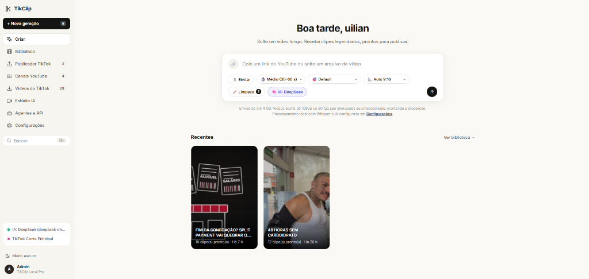
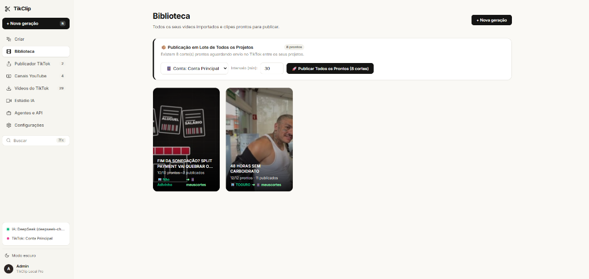
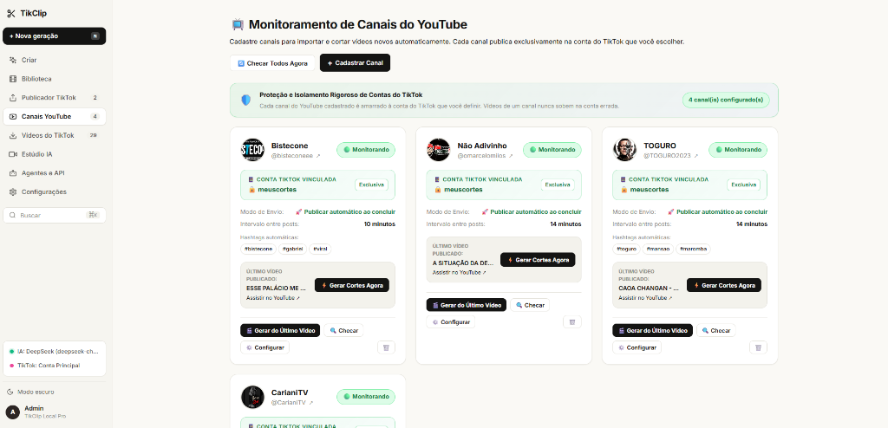
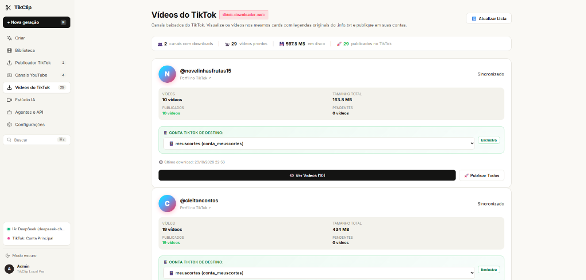
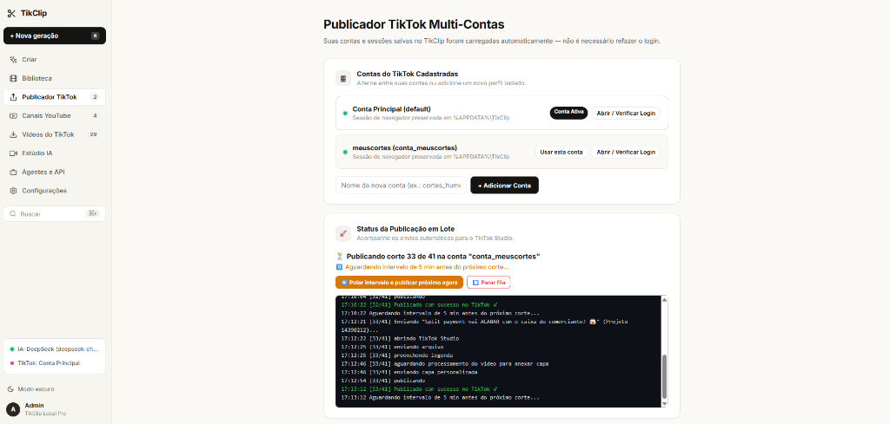
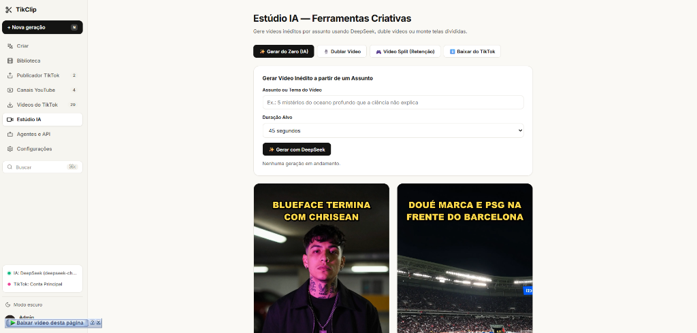
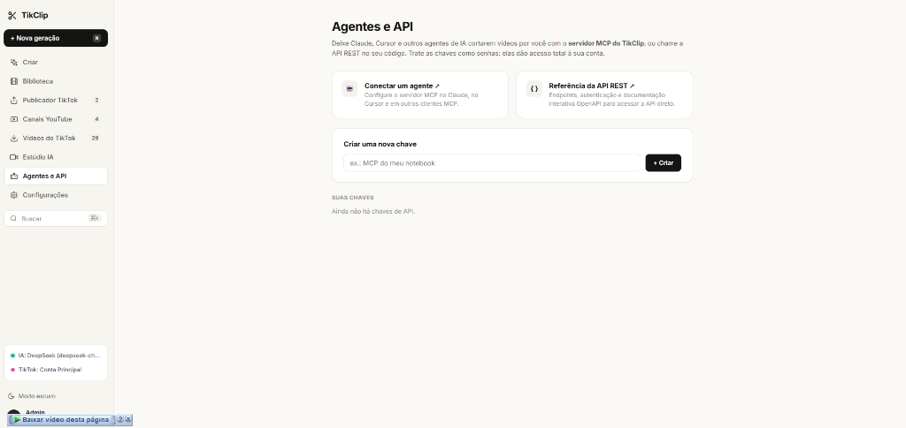
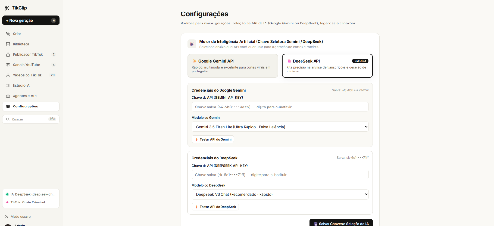

# 🎬 TikClip — Central Inteligente de Cortes, Monitoramento e Publicação Multi-Contas

<p align="center">
  
</p>

O **TikClip** é uma plataforma all-in-one de automação de conteúdo audiovisual com Inteligência Artificial. Projetado para criadores, agências e operadores de canais dark, o TikClip automatiza o ciclo completo de produção: desde o monitoramento de canais do YouTube e download, até a transcrição, corte inteligente vertical (9:16), geração de legendas dinâmicas e publicação automatizada em múltiplas contas do TikTok.

---

## 📸 Demonstração da Interface

Abaixo estão as principais telas e recursos do ecossistema TikClip:

### 1. Criar Cortes e Envio de Vídeos
Cole um link do YouTube ou envie um arquivo de vídeo longo. A IA transcreve o áudio, detecta os momentos virais e renderiza clipes verticais prontos.


---

### 2. Biblioteca de Cortes e Publicação em Lote
Acesse todos os seus projetos processados, visualize prévias e dispare publicações em lote com controle de intervalo entre postagens.


---

### 3. Monitoramento Automático de Canais do YouTube
Cadastre canais do YouTube por `@handle`. O TikClip detecta novos vídeos assim que forem postados, gera os cortes e publica automaticamente na conta do TikTok que você associar exclusivamente ao canal.


---

### 4. Gerenciador de Vídeos Baixados do TikTok
Importe e visualize vídeos baixados com títulos originais, descrições e hashtags prontas para republicação com extração automática de capas em alta resolução via FFmpeg.


---

### 5. Publicador TikTok Multi-Contas
Gerencie múltiplas contas do TikTok em perfis de sessão isolados com Playwright. Acompanhe a esteira de envio com console em tempo real e prevenção de bloqueios.


---

### 6. Estúdio IA — Ferramentas Criativas
Crie vídeos virais do zero a partir de uma ideia ou tema com DeepSeek, duble vídeos automaticamente ou crie vídeos com tela dividida (Split Screen) para retenção.


---

### 7. Agentes de IA e Servidor MCP
Conecte o TikClip ao **Claude Desktop**, **Cursor**, **Antigravity** ou qualquer cliente MCP (Model Context Protocol). Permita que agentes de IA recortem e publiquem vídeos por você.


---

### 8. Motor de IA Duplo (Google Gemini + DeepSeek)
Chave seletora em tempo real para alternar entre a API do **Google Gemini** (Gemini 2.5 Flash / Flash Lite) e **DeepSeek** (DeepSeek V3 Chat) com teste de conectividade integrado.


---

## ⚡ Principais Funcionalidades

- **Motor Duplo de IA (Dual Engine):** Escolha livremente entre **Google Gemini** e **DeepSeek** para análise semântica e identificação de ganchos virais.
- **Formatação Vertical Automática (9:16):** Reenquadramento dinâmico com foco nos oradores, desfoque de fundo (*blurred background*) ou tela dividida (*split-screen* de retenção).
- **Legendas Dinâmicas Estilo TikTok/Reels:** Sincronizadas palavra por palavra (*word-level timing*) geradas localmente com Whisper.
- **Monitoramento Passivo de Canais:** Verificação contínua de canais do YouTube; novos lançamentos são baixados e cortados sem intervenção manual.
- **Isolamento Rígido de Contas do TikTok:** Cada canal monitorado pode ser associado a uma conta específica, garantindo que nenhum vídeo seja postado no perfil errado.
- **Extração Inteligente de Capas:** O gerador de thumbnails extrai frames nítidos via FFmpeg para garantir capas de alta qualidade no TikTok Studio.
- **Automação via MCP e API REST:** API OpenAPI interativa e servidor MCP integrado para orquestração por LLMs autônomos.

---

## 🚀 Instalação Rápida

### Opção A: Instalação Automática com IA (Recomendado)
Se você utiliza o **Google Gemini**, **Cursor**, **Claude** ou outro assistente com acesso ao terminal:
1. Abra o arquivo [`INSTALL_PROMPT_GEMINI.md`](INSTALL_PROMPT_GEMINI.md).
2. Copie o prompt e cole no chat com o assistente.
3. O agente criará o ambiente virtual, instalará as dependências e iniciará o sistema automaticamente.

---

### Opção B: Instalação Manual

#### 1. Pré-requisitos
- **Python 3.10 ou superior** instalado.
- **FFmpeg** instalado e adicionado ao `PATH` do sistema.
  - Windows: `winget install Gyan.FFmpeg`
  - Linux (Ubuntu/Debian): `sudo apt update && sudo apt install -y ffmpeg`
  - macOS: `brew install ffmpeg`

#### 2. Clonar o Repositório
```bash
git clone https://github.com/SEU-USUARIO/tikclip.git
cd tikclip
```

#### 3. Criar e Ativar o Ambiente Virtual
- **No Windows:**
  ```powershell
  python -m venv .venv
  .venv\Scripts\activate
  ```
- **No Linux/macOS:**
  ```bash
  python3 -m venv .venv
  source .venv/bin/activate
  ```

#### 4. Instalar Dependências e Playwright
```bash
pip install -r requirements.txt
playwright install chromium
```

#### 5. Configurar Variáveis de Ambiente
Copie o arquivo de exemplo `.env.example`:
```bash
cp .env.example .env
```
*(As chaves do Gemini e DeepSeek também podem ser salvas diretamente pela aba **Configurações** na interface web).*

#### 6. Iniciar a Aplicação
- **No Windows (Dois cliques ou terminal):**
  Execute o arquivo `Iniciar TikClip.bat` ou digite:
  ```powershell
  python server.py
  ```
- **No Linux/macOS:**
  ```bash
  python server.py
  ```

Acesse em seu navegador:
👉 **[http://localhost:8585/ui/](http://localhost:8585/ui/)**

---

## 📂 Estrutura do Repositório

```text
tikclip/
├── backend/                  # Motor principal de processamento
│   ├── api/                  # Endpoints REST e rotas
│   ├── core/                 # Configurações de banco, tarefas e IA
│   ├── pipeline/             # Pipeline de corte, renderização e áudio
│   ├── services/             # Whisper, cookies do YouTube e integradores
│   └── utils/                # Manipulação de vídeo com FFmpeg e IA
├── docs/                     # Documentação e capturas de tela
│   └── screenshots/          # Imagens da interface utilizadas no README
├── web/                      # Interface Web moderna (HTML5, CSS3, JS Vanilla)
│   ├── css/                  # Estilos SupoClip
│   ├── js/                   # Controladores reativos da UI
│   └── index.html            # Dashboard principal
├── channel_monitor.py        # Módulo de monitoramento contínuo do YouTube
├── tiktok_library.py         # Gerenciador de biblioteca e capas do TikTok
├── server.py                 # Ponto de entrada do servidor ASGI/FastAPI
├── INSTALL_PROMPT_GEMINI.md  # Prompt para automação total de setup com IA
├── Iniciar TikClip.bat       # Launcher de um clique para Windows
├── requirements.txt          # Dependências Python
└── .env.example              # Modelo de configuração
```

---

## 🔒 Privacidade e Segurança
- O repositório está **100% limpo de credenciais e chaves**.
- Todas as sessões do navegador, cookies e chaves de API são armazenadas exclusivamente no ambiente local da sua máquina (`%APPDATA%/TikClip` no Windows ou diretório home).
- Nenhuma informação de conta ou mídia é enviada para servidores externos além das APIs oficiais configuradas pelo usuário.

---

## 📄 Licença
Distribuído sob a licença **MIT**. Consulte `LICENSE` para mais informações.
